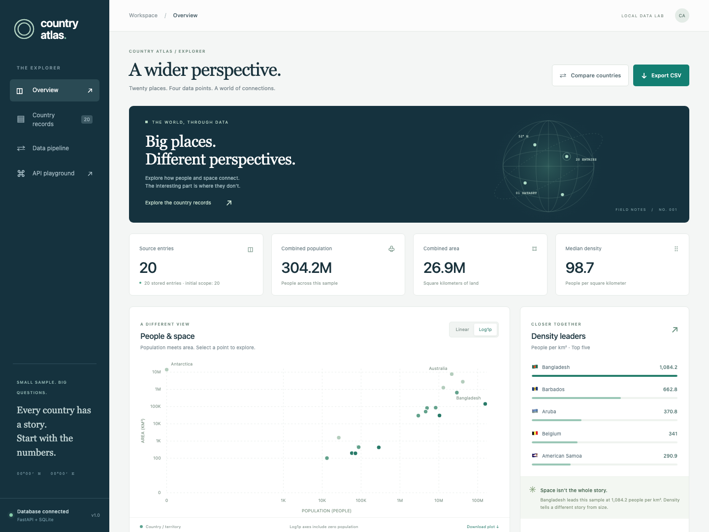
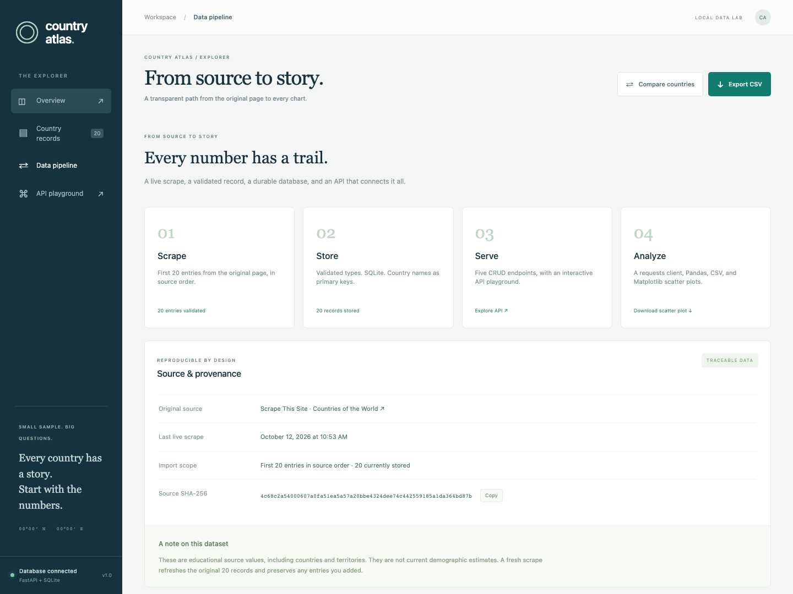
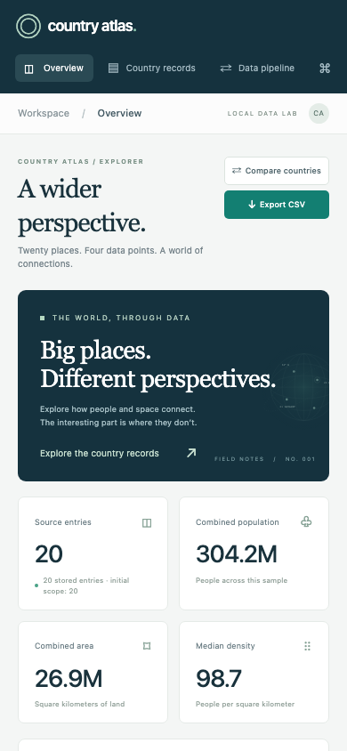
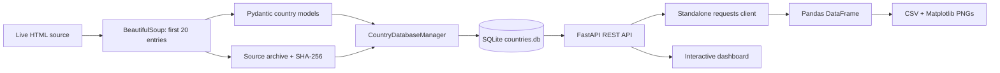
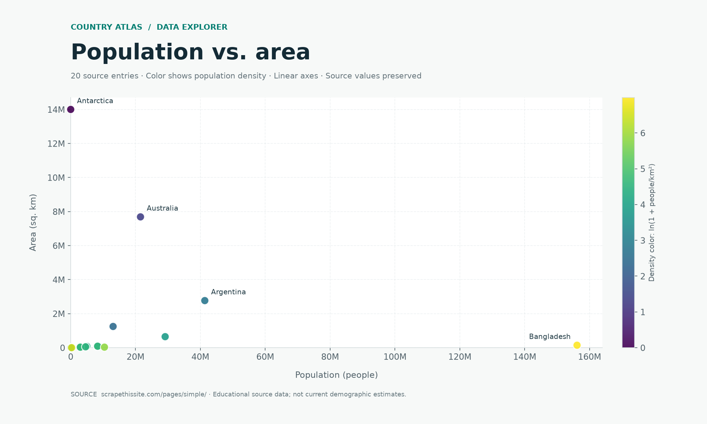

# Country Atlas

<div align="center">
  
  <h3>Twenty places. Four data points. A wider perspective.</h3>
  <p>A complete country-data pipeline with an interactive analytics dashboard.</p>
  <p>
    
    
    
    
  </p>
  <p><a href="#quick-start">Run locally</a> · <a href="#screenshots">Screenshots</a> · <a href="#how-the-pipeline-works">Pipeline</a> · <a href="#rest-api">API</a> · <a href="docs/DEMO.md">Demo guide</a></p>
</div>

## What is Country Atlas?

Country Atlas turns a small set of scraped country records into a complete, traceable data product. It fetches the **first 20 entries, in source order**, from [Scrape This Site](https://www.scrapethissite.com/pages/simple/), validates four fields, stores them in SQLite, exposes them through FastAPI, and produces CSV exports and Matplotlib charts through an independent HTTP client.

The dashboard adds a visual way to explore those same records: compare countries, inspect population and area, rank density, search the dataset, and create, update, or delete entries.

This is a Python capstone demonstrating web scraping, object-oriented database access, REST APIs, Pandas analysis, visualization, and end-to-end testing. The source values are educational examples, including countries and territories, rather than current demographic estimates.

## Screenshots

### Explorer dashboard

The overview combines dataset metrics, an interactive scatter plot, density rankings, and searchable country records.



<table>
  <tr>
    <td width="68%" valign="top"><strong>Data pipeline and source provenance</strong><br><br><a href="docs/images/pipeline.png"></a></td>
    <td width="32%" valign="top"><strong>Responsive mobile view</strong><br><br><a href="docs/images/mobile.png"></a></td>
  </tr>
</table>

Screenshots show the actual application with its original 20-entry dataset. Browser verification uses a temporary database, so demonstration edits do not alter the prepared data.

## Features

- **Live, scoped scraping:** extracts country name, capital, integer population, and numeric area from exactly the first 20 source entries.
- **Object-oriented SQLite CRUD:** a dedicated `CountryDatabaseManager` uses country name as the natural primary key.
- **Five required REST endpoints:** list, retrieve, create, update, and delete countries, with validation and clear HTTP errors.
- **Independent analytical client:** `client.py` uses `requests`, prints a Pandas DataFrame, and exports clean UTF-8 CSV data.
- **Presentation-ready charts:** a required linear population-versus-area scatter plot, plus a bonus Log1p view that includes zero population.
- **Interactive exploration:** clickable chart points, country details, side-by-side comparisons, search, sorting, and editing dialogs.
- **Traceable imports:** SHA-256 source archives and timestamps preserve evidence from successful imports, including after a later failed refresh.
- **Repeatable runs:** upserts refresh original entries without creating duplicates or deleting manually added countries.
- **Verified behavior:** 37 automated tests, lint and syntax checks, and desktop/mobile browser checks.

## Technology stack

| Layer | Technology | Responsibility |
| --- | --- | --- |
| Scraping | Requests + Beautiful Soup | Fetch the source HTML and parse its first 20 records |
| Validation | Pydantic | Enforce names, numeric types, bounds, and allowed fields |
| Persistence | Python `sqlite3` | Store records, perform CRUD, and commit imports atomically |
| API | FastAPI + Uvicorn | Serve REST endpoints and the dashboard |
| Analysis | Pandas + NumPy | Build DataFrames and calculate sample statistics |
| Visualization | Matplotlib | Generate downloadable scatter-plot PNGs |
| Dashboard | HTML, CSS, JavaScript, SVG | Present and edit data using the same REST API |
| Verification | Pytest, Ruff, Chromium | Check contracts, integration, code quality, and browser behavior |

SQLite is included with Python; it does not require a separate database server. The dashboard needs no Node.js installation or frontend build step.

## Quick start

### 1. Get the project

Clone this repository, or download and extract its ZIP using GitHub's **Code** button:

```bash
git clone https://github.com/Mshoaib04/country-atlas.git
cd country-atlas
```

### 2. Create an environment and install packages

Use **Python 3.12 or later**; development and verification used Python 3.14.8.

```bash
python3 -m venv .venv
source .venv/bin/activate
python -m pip install -r requirements.txt
```

On Windows Command Prompt, activate with `.venv\Scripts\activate.bat` instead. The virtual environment is intentionally excluded from GitHub; each clone creates its own environment.

### 3. Run the complete pipeline

```bash
python run_pipeline.py
```

This command performs a live scrape, commits the SQLite import, starts a temporary FastAPI server on an available localhost port, fetches `/countries` using the real HTTP client, prints the DataFrame, writes the exports, and stops the temporary server.

### 4. Start the dashboard and API

```bash
python -m uvicorn main:app --host 127.0.0.1 --port 8000
```

Open these addresses in your browser:

- **Dashboard:** http://127.0.0.1:8000
- **Interactive API playground:** http://127.0.0.1:8000/docs
- **Health check:** http://127.0.0.1:8000/health

After the environment and database are prepared, macOS/Linux users can run `bash start.sh`. It recognizes an existing Country Atlas instance on port 8000 and prints its links. Stop a server with Ctrl+C; configuration changes require a restart. If another application occupies port 8000, use `--port 8001` and adjust the client URL accordingly.

## How the pipeline works



| Step | Action | Result |
| --- | --- | --- |
| 1. Fetch | Request the original HTTPS page with timeouts and retry handling | Live source HTML |
| 2. Extract | Select only its first 20 `.country` elements | Four fields per entry, in source order |
| 3. Validate | Convert and validate population, area, names, and capitals | Consistent `Country` models |
| 4. Store | Upsert all rows and provenance in one SQLite transaction | Durable records with natural keys |
| 5. Serve | Expose database-manager operations through FastAPI | JSON CRUD endpoints |
| 6. Analyze | Fetch JSON using requests and build a Pandas DataFrame | Printed data, statistics, CSV, and PNGs |

Source archives live at `data/snapshots/<sha256>.html`. The convenient `data/source.html` pointer updates after a successful database import. A failed import cannot overwrite the source evidence for the preceding successful run.

### Run stages separately

```bash
# Live scrape and SQLite import
python scraper.py

# Run the API in one terminal
python -m uvicorn main:app --host 127.0.0.1 --port 8000

# In a second terminal, run the independent analytical client
python client.py --base-url http://127.0.0.1:8000

# Regenerate exports from the stored database without another live scrape
python run_pipeline.py --skip-scrape
```

The standalone client communicates through HTTP; it never reads SQLite directly.

## REST API

### Country record

```json
{
  "country_name": "Andorra",
  "capital": "Andorra la Vella",
  "population": 84000,
  "area": 468.0
}
```

`country_name` is the unique, non-null natural primary key. It is trimmed and Unicode-normalized, preserving accents such as **Åland**. Names are case-sensitive and remain unchanged during an update. Slashes and URL dot-segment names are rejected.

Population must be a nonnegative integer. Area is measured in square kilometers and must be finite and at least `0.000001` km². This lower bound matches the dashboard form and prevents density overflow. Unknown JSON fields are rejected.

| Method | Endpoint | Success | Operation |
| --- | --- | --- | --- |
| GET | `/countries` | 200 | Retrieve all countries; optional `?q=` country/capital search |
| GET | `/countries/{country_name}` | 200 | Retrieve a country by its name |
| POST | `/countries` | 201 | Create a record with a unique country name |
| PUT | `/countries/{country_name}` | 200 | Replace capital, population, and area |
| DELETE | `/countries/{country_name}` | 204 | Remove a record |

Use `application/json` for POST and PUT. Missing records return **404**, duplicate keys **409**, invalid inputs **422**, unsupported content types **415**, and bodies over 8 KB **413**. URL-encode spaces, accents, and punctuation in names.

### Example requests

```bash
curl http://127.0.0.1:8000/countries
curl 'http://127.0.0.1:8000/countries/United%20Arab%20Emirates'

curl -X POST http://127.0.0.1:8000/countries \
  -H 'Content-Type: application/json' \
  -d '{"country_name":"Demo Republic","capital":"Demo City","population":250000,"area":12500.5}'

curl -X PUT 'http://127.0.0.1:8000/countries/Demo%20Republic' \
  -H 'Content-Type: application/json' \
  -d '{"capital":"New Demo City","population":260000,"area":12500.5}'

curl -X DELETE 'http://127.0.0.1:8000/countries/Demo%20Republic'
```

Additional routes provide `/analytics/summary`, `/pipeline/status`, `/exports/countries.csv`, `/exports/population_vs_area.png`, and `/openapi.json`. Add `?log_scale=true` to the PNG export for the bonus Log1p chart.

## Exports and analytics

| File | Contents |
| --- | --- |
| [exported_countries.csv](exported_countries.csv) | Four required fields, UTF-8, no DataFrame index |
| [population_vs_area.png](population_vs_area.png) | Required linear scatter: population on X, area on Y; title, axis labels, gridlines |
| [population_vs_area_log.png](population_vs_area_log.png) | Bonus Log1p scatter including zero population |
| [analytics_summary.json](analytics_summary.json) | Record count, population/area totals, median density, rankings, and correlation |
| `pipeline_manifest.json` | Locally generated run metadata and provenance |



The initial sample contains **304,224,742 people** across **26,888,881 km²**, with a median density of **98.72 people/km²**. Bangladesh leads the sample in density; Antarctica is its largest entry by area. These are sample statistics from the educational source.

**Log1p** means `ln(1 + x)`, which keeps zero population visible. The assignment's required PNG uses linear axes. Density is calculated as `population / area`.

Dashboard downloads reflect the current database. Files generated by `client.py` are snapshots; rerun the client after edits to refresh them. Free-form CSV strings with spreadsheet formula prefixes are escaped while numeric fields remain numeric.

## Project structure

```text
country-atlas/
├── country_atlas/               # Models, scraper, database manager, API, analytics
├── static/                     # Dashboard HTML, CSS, JavaScript, favicon
├── tests/                      # API, database, scraper, and integration tests
│   └── fixtures/               # Captured first-20 HTML for offline tests
├── scripts/                    # Browser checks and project packaging
├── docs/                       # Demo guide, report, and application screenshots
├── main.py                     # FastAPI entrypoint: main:app
├── scraper.py                  # Standalone live import
├── client.py                   # Standalone requests/Pandas export client
├── run_pipeline.py             # Complete pipeline in one command
├── start.sh                    # Local dashboard launcher
├── requirements.txt            # Runtime dependencies
├── requirements-dev.txt        # Test and development dependencies
├── requirements.lock.txt       # Exact verified dependency versions
├── pyproject.toml              # Pytest and Ruff configuration
└── .gitignore                  # Excludes environments, caches, databases, and local state
```

`countries.db`, virtual environments, caches, source archives, local manifests, and handoff ZIPs are generated locally and excluded from Git. The repository includes source code, test fixtures, screenshots, and sample CSV/PNG/JSON outputs.

## Testing

```bash
python -m pip install -r requirements-dev.txt
python -m pytest -q
ruff check .
ruff format --check .
```

**37 tests pass.** Coverage includes source order and the 20-entry limit, Unicode names, zero population, OOP CRUD and persistence, duplicate conflicts, atomic rollback, HTTP routes, input validation, non-finite numbers, density bounds, source-archive integrity, custom database startup, CSV/PNG exports, empty datasets, read-only mode, and real HTTP integration.

Optional browser verification:

```bash
PLAYWRIGHT_BROWSERS_PATH=.cache/playwright python -m playwright install chromium
python scripts/check_dashboard.py
```

Chromium checks cover chart interactions, comparison, search, sorting, downloads, CRUD, duplicate errors, safe text rendering, and mobile behavior. `requirements.lock.txt` pins the verified runtime/test dependencies and requires Python **3.12+**. Install it when reproducing the exact development environment.

## Configuration

| Environment variable | Default | Purpose |
| --- | --- | --- |
| `ATLAS_DATABASE_PATH` | Project-root `countries.db` | Choose a different persistent database file |
| `ATLAS_READ_ONLY` | `0` | Set `1` to disable POST, PUT, and DELETE |
| `ATLAS_ALLOWED_HOSTS` | `localhost,127.0.0.1,testserver` | Comma-separated accepted hostnames |

A refresh updates or restores the original 20 source entries and preserves manually added records. CRUD edits can therefore change the stored count. The source's zero-population Antarctica entry and literal `None` capital are preserved.

This application is intended for local, single-user use. Public app hosting should use read-only mode, HTTPS, an explicit allowed hostname, and persistent SQLite storage. Public write access needs authentication and authorization. **A public GitHub repository does not deploy the API**, and static GitHub Pages cannot run its Python backend.

## Learn more

- [Three-minute demonstration and viva questions](docs/DEMO.md)
- [Implementation and verification report](docs/PROJECT_REPORT.md)
- [Original educational data source](https://www.scrapethissite.com/pages/simple/)
- [FastAPI response models](https://fastapi.tiangolo.com/tutorial/response-model/)
- [Matplotlib scatter API](https://matplotlib.org/stable/api/_as_gen/matplotlib.axes.Axes.scatter.html)
